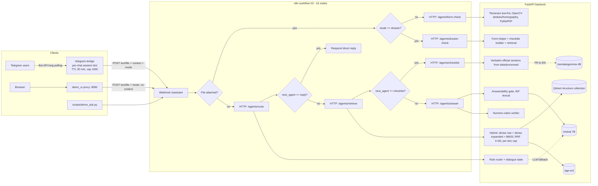

# Architecture verification (audit, 2026-10-17)

This document records the architecture **as deployed** on the audit date, established from the running
containers, the deployed n8n workflow export and source-hash comparisons. It is not based on design
documents. It is an audit snapshot only; nothing was modified.

## 1. Deployed components (verified)

| Component | Deployed artifact | Verified how |
|---|---|---|
| FastAPI backend | Image `tunisian-admin-assistant-backend` (container created 2026-10-17 11:30 UTC). Port 127.0.0.1:8000. | `docker inspect`; `/health` → `{"qdrant":true,"ollama":true,"manifest_records":14}` |
| n8n | `n8nio/n8n:2.41.3`. Workflow `TnaaAssistant01` active, 16 nodes, `versionId = activeVersionId = 92f81ea7…`, updated 2026-10-17 11:16 UTC. `TnaaRetrieveApi1` active, 3 nodes. `TnaaIngestIndex1` inactive, 5 nodes. | Read-only `n8n export:workflow --all` inside the container |
| Workflow definition vs repository | Identical: same 16 node names, identical node parameters and identical connections to `workflows/03_assistant_multi_agent.json` | JSON comparison |
| Qdrant | `qdrant/qdrant:v1.19.0`, 127.0.0.1:6343. `official_docs_structure` = 272 points, `official_docs_recursive` = 174 points (cosine, 1024-d). | Collections API, exact count |
| Ollama (host, not in Docker) | `bge-m3` (567M, F16), `mistral:latest` (7.2B Q4_K_M), `translategemma:4b` (4.3B Q4_K_M). GPU: 4 GB. Mistral was loaded with only about 2.1 GB in VRAM (partial CPU offload). | `/api/tags`, `/api/ps`, `nvidia-smi` |
| Telegram bridge | Image `tunisian-admin-assistant-telegram` (container created 11:22 UTC). A token is configured: the value was not read, only its presence was checked. **Live:** the log shows `telegram_bridge_started`, which is emitted only after `getMe`, `setMyCommands` and `deleteWebhook` succeed. 4 real text messages were answered between 11:22 and 11:35 UTC; no upload is in the logs. | Sanitized log scan: event names and metadata only |
| Web fallback | `demo_ui/app.py` (127.0.0.1:8090), same webhook and payload | `tests/test_demo_ui.py` (16 pass) |
| Isolated candidate stack (not production) | `post-audit-candidate` backend (127.0.0.1:8001) and `post-audit-n8n` (127.0.0.1:5679), started about 14:10 UTC by another workstream | `docker ps` |

### Source drift: repository vs deployed backend (critical for interpreting any test)

SHA-256 comparison of the repository files with `/app` in the running backend container:

- **8 files differ:** `agents/answer.py`, `agents/checklist_builder.py`, `agents/dialogue.py`,
  `agents/intent_router.py`, `agents/retriever.py`, `agents/schemas.py`, `backend/agents_api.py`.
- **1 file is missing from the deployed image:** `agents/legal_evidence.py`.
- **All other files are identical:** every `rag/` file, every prompt (bind-mounted), and the remaining agents.
- `telegram_bridge/contracts.py` also differs between the repository and the bridge container. The new
  `rne_code` and `legal_subject` context fields are absent from the deployed bridge.

The differences are the uncommitted, undeployed "post-audit" fixes. They target RNE exact-code lookup,
CIN loss scenarios, the Arabic `من أجل` keyword and legal-subject context, and run only in the isolated
candidate stack. **Production still runs the code the 846-case audit measured:** the deployed hashes
equal those recorded in `data/evaluation/full_document_coverage_deployment.json`. The repository is
not a git repository, so there is no commit history to identify releases.

## 2. Component diagram (as deployed)

## 3. Actual request flows

| Path | Steps (verified) | Model calls |
|---|---|---|
| Text → checklist | webhook → `/agents/route` (rules) → `/agents/retrieve` (hybrid) → `/agents/checklist` (verbatim sections from extracted official text) → respond | None for FR/AR; translategemma for EN (FR→EN, validated) |
| Text → grounded answer | webhook → route → retrieve → `/agents/answer`. The answerability gate runs first. Mistral receives the numbered passages (prompt `grounded_answer` v2). Citation numbers must be in range, and the numeric verifier removes sentences whose numbers are absent from the passages. Otherwise the agent falls back to quoting passages. | mistral (observed 20–176 s) |
| Text → direct reply | Route returns `next_agent = reply` (greeting, uncovered procedure, clarification) | None; LLM classification only on rule miss |
| Upload → form check | webhook → `/agents/form-check`. Template matching against the 2 official RNE forms: PDF text layer or Tesseract OCR, with deskew and homography for photos. Result: field statuses and missing labels. | None |
| Upload + `mode=dossier` | webhook → `/agents/dossier-check`. Form check, plus retrieval of official requirements, plus a deterministic readiness report. `completeness_certified` is always false. | None (embedding only) |

### Context flow (multi-turn)

- **Where state lives.** The backend and n8n are **stateless**. Dialogue state (`DialogueContext`: category,
  hints, residence, declared items, pending and last intent) lives **only in the Telegram bridge's
  in-memory session**. It is keyed by Telegram `chat.id`, expires after 30 minutes, holds at most 1000 sessions,
  and is lost on restart. It travels in each request as `context`; the router returns an updated context.
- **The context key changes the backend path.** When `context` is present, even as an empty `{}`, the router
  uses `route_dialogue` and canonical queries. Without it (web fallback, CLI, evaluation scripts) the
  stateless path runs. Telegram users and web users therefore get **different backend behaviour** for the
  same question (see gap G-01).
- **n8n stores nothing:** `saveDataSuccessExecution` and `saveDataErrorExecution` are both `none`.

## 4. Agent responsibilities (actual)

| Component | Type (evidence-based) | LLM? | Input → output |
|---|---|---|---|
| Intent Router (`agents/intent_router.py`, `agents/dialogue.py`) | Rule-based classifier with LLM fallback; dialogue state machine | Only on rule miss (`intent_router` v1) or fact extraction without a rule cue (`dialogue_understanding` v3) | `RouteRequest` → `RouteDecision` (+context) |
| RAG Retriever (`agents/retriever.py`, `rag/hybrid.py`) | Deterministic retrieval pipeline | No (embeddings only) | query + route → 8 passages |
| Checklist Builder (`agents/checklist_builder.py`) | Deterministic extractor of verbatim official sections; optional LLM translation | translategemma for EN only | passages → sections + citations |
| Grounded Answer (`agents/answer.py`) | LLM generator with deterministic guards | mistral | passages → cited answer or refusal |
| Form-Filling Helper (`agents/form_helper.py`) | Deterministic document analysis (template matching, OCR) | No | file → field statuses |
| Dossier Validator (`agents/dossier_validator.py`) | Deterministic composition of form helper, retrieval and checklist evidence | No | file → readiness report |
| Evidence verifier (`agents/verification.py`) | Deterministic numeric check; LLM topic check is **disabled** (`evidence_topic_check=False`) | No (topic check off) | answer + passages → filtered answer |

**Classification.** This is a **sequential, n8n-orchestrated pipeline of specialised agent-like services**
with fixed branching. The agents do not negotiate, plan, call each other or choose tools at run time.
n8n does more than forward requests: it performs the branching (4 IF nodes) and the data hand-offs
between agents. The branching decisions themselves (`next_agent`) are computed by the backend router.

## 5. Failure paths (verified from workflow and code)

| Failure | Behaviour |
|---|---|
| Backend agent HTTP error or timeout | n8n nodes have **no `onError`/retry settings and no error workflow** (verified). With n8n defaults the execution fails and the webhook returns an n8n error instead of a structured reply. This is UNVERIFIED in this audit, because exercising it would require stopping a production service. The bridge retries up to 3 times on network errors and 5xx, then sends a localized error message. The web proxy returns 502 with a generic message. |
| Ollama failure in the grounded answer | `LLMError` is caught and the agent falls back to quoting the top passages (`passages_fallback`) |
| Router LLM fallback failure | Logged as `intent_llm_failed`; default category |
| Empty retrieval | `not_found` message, `found=false` |
| Weak lexical support (non-rule category) | `insufficient_evidence` refusal |
| Number in the answer absent from the passages | Sentence removed; if no cited sentence remains, the answer is refused (`unsupported_claim`) |
| Unsupported upload type or size | Rejected by the bridge, proxy or backend before analysis |
| Malformed JSON from the LLM (dialogue, topic) | Validated with Pydantic; discarded on failure |

## 6. Designed vs deployed

| Design claim (report or docs) | Deployed reality |
|---|---|
| "Five agents orchestrated by n8n" | Correct as a description of 5 HTTP agent nodes plus the dossier node (6 agent endpoints). They are specialised services in a fixed pipeline, not autonomous agents. |
| Report Section 6: "Telegram tested with mocked API; live conversation pending" | Telegram is now live (4 real messages answered). The report and `docs/TELEGRAM_REPORT.md` predate this. |
| Report evaluation (84 items, held-out 20) | Measured on 2026-10-16 **before** the dialogue layer was deployed, and only through the context-free request shape. **No reported metric covers the Telegram context path now in production.** |
| Post-audit fixes in the repository | Not deployed. They run only in the candidate stack (ports 8001 and 5679). |
| Prompt registry `grounded_answer` | Active v2. v3 exists, was evaluated (`agent_results_prompt_v3.json`) and was not adopted. |
| Topic verification | Implemented but disabled by default |
