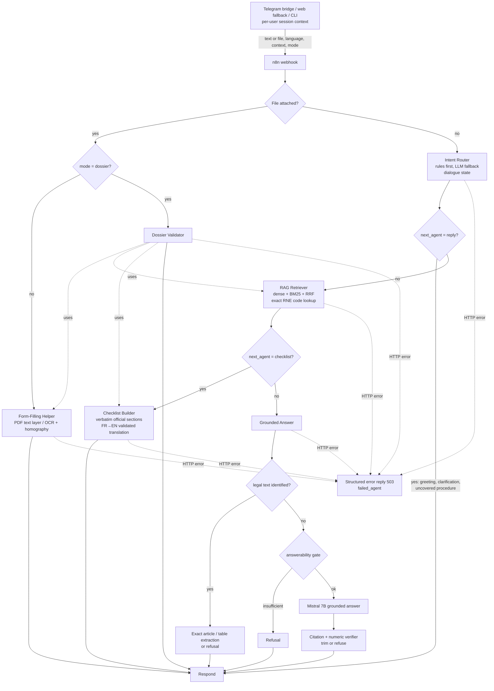

# Multi-agent architecture assessment (final candidate, 2026-10-17)

**Question addressed:** is the Tunisian Administrative Procedures Assistant a genuine multi-agent system,
and which architectural description does the implementation actually support?

**Method:** the conclusions below come from the source code, the n8n workflow definition and runtime logs of
the final candidate. Six components being *named* "agents" is not taken as evidence.

## 1. Verdict

**Classification: an orchestrated multi-agent architecture of specialised agents. It is not an autonomous
multi-agent system.**

- n8n acts as the orchestrator and owns the control flow. It holds five conditional branches (four IF nodes and an
  error branch) and passes structured JSON between six specialised backend agents.
- Each agent has a typed input/output contract (Pydantic models in `agents/schemas.py` and
  `agents/dossier_validator.py`) and a single responsibility.
- Only **two** agents generate text with an LLM:
  - the Grounded Answer agent (Mistral 7B);
  - the Checklist Builder's optional translation step (TranslateGemma 4B).
- **One** agent uses an LLM only as a classification fallback: the Intent Router (Mistral 7B, JSON, enumeration-validated).
  Its dialogue extractor is also LLM-assisted when no rule fires.
- The remaining agents are deterministic specialised services:
  - Retriever;
  - Form-Filling Helper;
  - Dossier Validator;
  - the legal-evidence extractor inside the Grounded Answer agent;
  - all verifiers.
- **No component plans, selects tools at run time, negotiates with other agents or loops autonomously.**
  Decisions are made by explicit rules (routing, answerability, verification), which is a deliberate choice
  for a safety-critical, citation-bound domain.

The defensible academic description is therefore: **"an orchestrated, multi-agent-inspired architecture
with specialised agents and deterministic verification"**. It is more than a single-chain modular RAG pipeline,
because it has distinct agents with separate contracts and different reasoning methods, and conditional
orchestration between them. It is **not** an autonomous multi-agent system.

## 2. Component inventory and classification

| # | Component (source) | Responsibility | Input → output contract | LLM use | Tools / state | Classification |
|---|---|---|---|---|---|---|
| 1 | **Orchestrator**: n8n workflow 03 (`workflows/03_assistant_multi_agent.json`, 17 nodes) | Entry point; branches on file / mode / `next_agent`; passes outputs between agents; structured error reply | Webhook JSON → agent JSON | None | Stateless; executions not stored | Ordinary workflow orchestration (the coordination layer) |
| 2 | **Intent Router** (`agents/intent_router.py`, `agents/dialogue.py`) | Language, procedure category, intent, application hints, next agent; dialogue state (category, hints, residence, declared items, RNE code, legal subject); clarification questions | `RouteRequest{text, language?, context?}` → `RouteDecision{language, intent, procedure_category, hints, next_agent, reply?, context, retrieval_query}` | Mistral 7B **only** when no keyword rule identifies the procedure (`intent_router@v1`), or for fact extraction without a rule cue (`dialogue_understanding@v3`); both outputs schema-validated | Conversation state is carried by the client (Telegram bridge), not stored server-side | **Tool-using specialised agent with rule-first decision logic** (makes the routing decision consumed by n8n) |
| 3 | **RAG Retriever** (`agents/retriever.py`, `rag/hybrid.py`) | Evidence retrieval: dense BGE-M3 (raw + expanded query), BM25, RRF fusion, per-document cap; exact Qdrant lookup for RNE codes | `AgentRetrieveRequest{query, route, top_k}` → `AgentRetrieveResponse{passages[]}` | None (embeddings only) | Qdrant, BM25 index | Deterministic specialised service |
| 4 | **Checklist Builder** (`agents/checklist_builder.py`) | Selects the official scenario and quotes complete official sections verbatim; RNE table rows; FR/AR conflict warnings; optional FR→EN translation | `ComposeRequest{query, route, passages}` → `ChecklistResult{sections, citations, warnings, translation}` | TranslateGemma 4B for FR→EN only (`translate_items@v1`), rejected unless every line and number is preserved | Extracted official structure | **LLM-powered specialised component** (LLM restricted to validated translation) |
| 5 | **Grounded Answer** (`agents/answer.py`, `agents/legal_evidence.py`, `agents/answerability.py`, `agents/verification.py`) | Answers free questions. **Escalation inside the agent:** (a) the six legal texts are answered by locating and quoting the exact article or table, with no generation; (b) otherwise the answerability gate decides whether to answer; (c) Mistral 7B generates a cited answer; (d) the citation and numeric verifiers accept, trim or refuse | `ComposeRequest` → `AnswerResult{text, method ∈ {passages_fallback, llm_grounded, none}, citations, verification}` | Mistral 7B (`grounded_answer@v2`) for non-legal free questions only | Corpus extraction | **Tool-using specialised AI agent** (chooses between extraction, generation and refusal according to evidence) |
| 6 | **Form-Filling Helper** (`agents/form_helper.py`) | Recognises official forms F-001/F-002 in PDFs and images; field statuses | `FormCheckRequest{file}` → `FormCheckResult{recognised, fields, missing}` | None | PyMuPDF, Tesseract `ara+fra`, OpenCV deskew/homography | Deterministic specialised service (multimodal) |
| 7 | **Dossier Validator** (`agents/dossier_validator.py`) | Readiness report: field statuses, official requirements quoted verbatim, explicit non-certification | `FormCheckRequest` → `DossierReport{filled, missing, unreadable, cannot_verify, official_requirements, completeness_certified=false}` | None | **Calls other agents' capabilities:** Form Helper, Retriever, Checklist Builder | Deterministic specialised service; the only component that composes other agents directly |
| 8 | Telegram bridge (`telegram_bridge/`) | Channel adapter; per-user session state (dialogue context, language, upload mode) | Telegram update → webhook payload | None | In-memory sessions (30 min TTL) | Interface component, not an agent |

**Runtime evidence:** final-candidate backend logs show `agent_route`, `agent_retrieve`, `agent_checklist`,
`agent_answer`, `agent_form_check` and `agent_dossier_check` events for the 728-case replay. All requests
entered through the n8n webhook (`POST /webhook/assistant` on the candidate n8n instance).

## 3. Orchestration and data flow

## 4. Why this architecture fits administrative assistance

| Task type | Why a separate specialised agent | Evidence |
|---|---|---|
| Official checklists (passport, CIN) | Lists must be **complete and verbatim**; chunk-based generation truncates or paraphrases lists. The Checklist Builder reads the full official section after retrieval has identified the scenario. | Guide scenarios: required spans fully present in 72/72 (final candidate). The original production audit measured 68/72. |
| RNE fee and deadline rows | A procedure code is an **exact key**, not a semantic-similarity question; generic generation substituted neighbouring rows. | Contextual RNE 190/190 and context-free 190/190 with the exact-key path. Original production: 0/190 contextual; 188/190 context-free with I 001/I 002 substituted. |
| Legal provisions | Paraphrase by a 7B model produced a fabricated Article 16 and misattributed articles despite valid citations. Article identity is resolved deterministically and the text is quoted. | Legal passage containment (independent post-fix audit): candidate 23/25 direct factual vs. 1/30 for the generic LLM path; Art. 16 fixed; Art. 999 refused. |
| Free questions outside these structures | Only here is generation useful; it is fenced by an answerability gate and numeric verification. | Numeric verifier removed every unsupported number on five evaluation sets (report, Table "verification"). |
| Forms and dossiers | Images and PDFs need geometric/OCR processing, not language modelling. Readiness must never be certified by a model. | 8/8 official upload cases (F-001/F-002 × PDF/PNG × form/dossier); `completeness_certified=false` in every dossier case. |
| Safety and refusal | Rules decide when to refuse or clarify, so behaviour is predictable and auditable. | Uncovered birth certificate 4/4; corrupt/unsupported uploads 6/6 safe; article without act → clarification. |

**Comparison with a single generic RAG agent (ablation-style, existing measurements only).** The original
production system sent RNE follow-ups and legal questions through a generic path: retrieve passages, then let
one LLM compose the answer. On the same suite cases:
- the generic path produced source-only replies for all 190 contextual RNE questions;
- its answers contained the official legal passage in 1/30 direct legal questions (0/18 scenario-specific,
  0/12 multilingual);
- it fabricated Article 16.

The specialised agents answer these cases with 190/190 exact rows and 23/25 contained legal passages. This is
**not** a controlled single-agent baseline (the systems differ in more than one component), and no new
baseline measurement was invented. It is the measured difference between the generic and the specialised
paths of the same project.

## 5. Changes made in this cycle (architecture-relevant)

1. **Evidence-aware legal escalation** inside the Grounded Answer agent:
   - table-level extraction;
   - IDF ranking that ignores the act's own title words;
   - cross-lingual search vocabulary;
   - penalty questions routed to Law 2018-52 (Art. 55);
   - complete article boundaries (Arts. 20/27).
2. **Dialogue state:** article-number follow-ups keep the legal subject; an article without an identifiable act
   triggers a clarification instead of an LLM guess.
3. **Session isolation:** group chats now have per-member sessions keyed by (chat id, numeric user id).
4. **Failure handling in the orchestrator:**
   - every agent HTTP node now has an error output connected to a structured `503` reply naming the failed agent;
   - previously, a backend failure surfaced as an unstructured n8n execution error;
   - clients keep their behaviour: the bridge retries and then sends a localised error, and the web proxy shows a
     generic message.

**Not done, deliberately:**
- no new autonomous agent;
- no LLM planner;
- no LLM-based re-ranking or self-reflection loop.

On a 4 GB GPU each extra Mistral call costs 20–190 s under contention (independent post-fix audit, §10), and
generative self-checks were shown to be unstable (`evidence_topic`, report Section 7).

## 6. Trade-offs and limitations

- **Predictability over flexibility.** Rule-first routing fails on unforeseen phrasings (8 form-instruction
  questions still receive generic help). An LLM router would generalise better but would make routing
  non-deterministic and slower.
- **Verbatim legal answers.** Quoting whole articles is faithful but long, and untranslated for English and
  French users of Arabic texts.
- **Client-held conversation state.** Simple and private (no server-side store), but lost on bridge restart.
- **Shared GPU.** All LLM-backed agents share one Ollama instance; concurrency degrades every embedding- or
  LLM-dependent agent.
