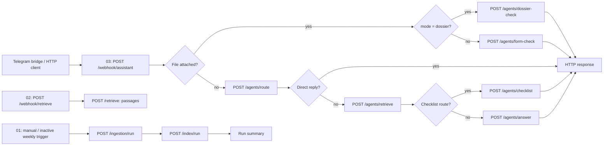

# Three-workflow architecture — reviewed 17 October 2026

Scope: baseline `a5aef273e7d7d4d888efbb92645f15c219bbf48a`, branch `codex/final-n8n-workflows`. This is an orchestrated multi-agent application: n8n controls fixed branches and FastAPI supplies specialized services. It is not an autonomous planning or agent-negotiation system. No executable AI Agent nodes have been added.

## Verified live definitions

| Workflow / editor | Live state | Executable nodes | Repository difference / risk |
|---|---|---:|---|
| [01 — Official corpus: ingest and index](http://localhost:5678/workflow/TnaaIngestIndex1) | Inactive, unpublished | 5 | Same execution graph; ingestion/indexing can overwrite corpus collections. Never execute during demonstration. |
| [02 — Retrieval API (RAG Retriever agent entry point)](http://localhost:5678/workflow/TnaaRetrieveApi1) | Active, published | 3 | Repository says inactive; candidate preserves live active state. Dense `/retrieve`, not the routed hybrid agent. |
| [03 — Assistant: multi-agent orchestration (Telegram / HTTP entry point)](http://localhost:5678/workflow/TnaaAssistant01) | Active, published | 16 | Repository is inactive and has 17 nodes: six HTTP error outputs and a shared 503 response, missing live. Candidate retains these branches and preserves live active state. |

The three live exports contain no Sticky Notes and no credential references. Their private backups and structured differences are recorded in [COMPARISON](../deploy/n8n_review/COMPARISON.md). Historical candidate/rollback exports are not authoritative live definitions. Workflow 03 does **not** invoke workflow 02.

## Component inventory and implementation boundary

| Component | Classification | Inputs → outputs; dependencies and limits |
|---|---|---|
| n8n | External orchestration platform | Webhooks, IF conditions, HTTP nodes, response nodes; fixed connections, no independent planning. |
| Intent Router, `/agents/route` | Rules + LLM fallback | Question/language/context → intent/category/public facts/direct response; Mistral only when needed. |
| RAG Retriever, `/agents/retrieve` | Deterministic retrieval with embeddings | Routed request → official passages/citations; Qdrant + BGE-M3; raw/expanded dense and BM25 fused with RRF and document caps. Reviewed candidate also has exact RNE lookup. No learned cross-encoder reranker. |
| Raw retrieval, `/retrieve` | Embedding/dense service | `query`, `top_k`, `strategy`, `filters`, `min_score` → passage list containing `chunk_id`, `text`, `score`, citation. Does not run the Intent Router or hybrid agent pipeline. |
| Checklist Builder, `/agents/checklist` | Deterministic official section/table extraction; conditional translation | Routed evidence → checklist/fee/deadline response. FR→EN uses TranslateGemma with line/number checks where supported. Source conflicts and insufficient support must remain explicit. |
| Grounded Answer Generator, `/agents/answer` | Deterministic gates + LLM generation | Evidence → answer/citations or refusal; Mistral, citation-index checks, numerical evidence checks, quote fallback; optional topic check is disabled by default. Citation validity alone does not prove entailment or answer correctness. |
| Form-Filling Helper, `/agents/form-check` | Deterministic PDF/image analysis | In-memory upload → recognized form and potentially missing/unreadable fields; RNE F-001/F-002, PDF geometry or Tesseract/OpenCV OCR and alignment. No legal completeness certification. |
| Dossier Validator, `/agents/dossier-check` | Deterministic composed service | Internally reuses form/retrieval/checklist evidence; distinguishes filled/missing/unreadable/unverifiable fields and supported/unverified requirements. No extra n8n internal-agent calls needed. |
| Legal evidence / citations | Deterministic reviewed backend module | Six indexed acts, exact articles/tables and identification checks; original source passages and limitations. This module exists in the candidate backend, **not in the current production image**. |
| Ingestion / extraction / indexing | Deterministic backend pipeline | Official registry, robots/opt-outs, TLS, SHA provenance and duplicate tracking; HTML/tables and PyMuPDF text/font/legal structure, normalization; recursive and structural chunks; BGE-M3 1024-dimensional embeddings; recreates both Qdrant collections. Image-only corpus PDFs are skipped: upload OCR is not ingestion OCR. |
| Telegram bridge | External interface with deterministic session/formatting controls | Sends HTTP to workflow 03, formats citations/reports; upload memory/size restrictions. Reviewed bridge has per-member TTL context, cancellation and concurrency bounds. Do not infer that all reviewed changes are in the older live image. |
| Qdrant / Ollama | External data / inference services | Separate recursive/structural collections; models `bge-m3`, `mistral:latest`, `translategemma:4b`. No new model calls introduced by this work. |

Source anchors: `backend/main.py`, `backend/agents_api.py`, `backend/settings.py`, `agents/`, `rag/`, `ingestion/`, `telegram_bridge/`, `workflows/`. Existing versioned prompts remain unchanged.

## Contracts, errors and privacy

Workflow 03 preserves all existing request/response expressions. A document request with `mode: "dossier"` uses dossier validation; ordinary form uploads omit mode. Text remains on the routing path. Output citations and informational/legal limitations remain intact. Upload values must never be logged or placed in fixtures.

HTTP timeouts: workflow 01 ingestion/index each 900 s; workflow 02 retrieval 120 s; workflow 03 form/dossier 300 s, router/retrieval 180 s, checklist/answer 600 s. No HTTP node retries were added. Workflows 01/02 stop on backend failure without a custom response branch. Candidate 03 maps each of six HTTP error outputs to a localized, sanitized JSON 503 (`agent_unavailable`), without raw errors or file values. This also maps 401/403/422/429 to 503: status specificity is a known limitation. Successful but malformed payloads are not comprehensively schema-validated by n8n; backend schemas and expressions remain unchanged.

Empty evidence must lead to clarification/refusal, not invented requirements. Bridge HTTP retries are bounded (up to three attempts for network/5xx failures); Telegram sends are not blindly retried. Transport error routing does not establish semantic correctness.

## Runtime separation

Production: backend `8000`, n8n `5678`, Telegram bridge and project Qdrant on the shared internal network. Bridge uses `http://n8n:5678/webhook/assistant`. Persistent n8n data is in `tunisian-admin-assistant_n8n_data`; repository `/workflows` is mounted read-only and edits do not update the database.

Inspected but untouched: final candidate backend `8002` / n8n `5680`, older candidate backend `8001` / n8n `5679`. The unrelated Qdrant on host `6333` belongs to another project; project Qdrant is exposed on loopback `6343`. Never use the unrelated instance for this release.

Production source lacks the reviewed security settings and legal module. Its health and the repository's passing tests do not prove those features are deployed. See [security](N8N_SECURITY_INTEGRATION.md) and [release gates](N8N_DEPLOYMENT_CHECKLIST.md).
