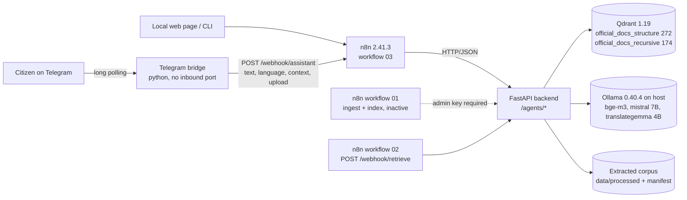
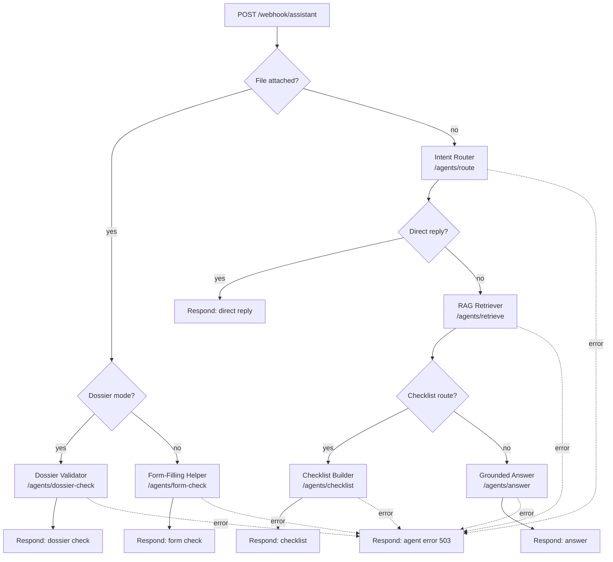
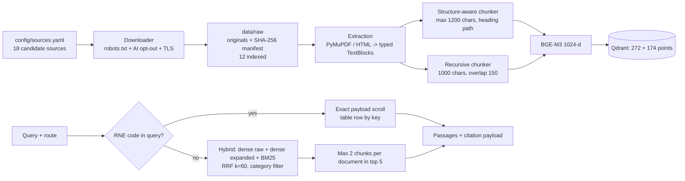
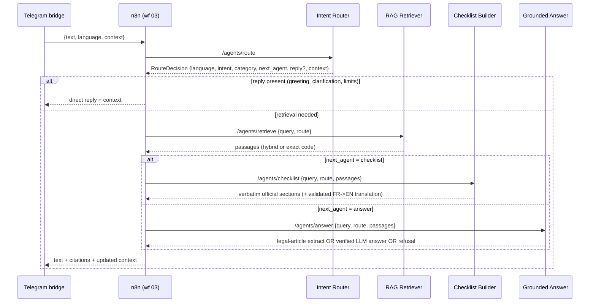
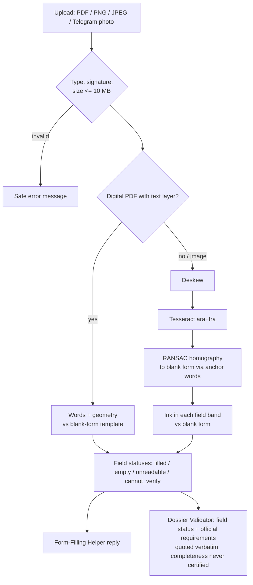

# Diagram specifications

Every diagram below was derived from the code and the committed workflow files on branch
`overnight/finalization` (base `be787ca`). The **source of truth** is named under each diagram. The editable
PowerPoint versions are drawn with native shapes in `FINAL_PRESENTATION.pptx` (slides 4, 5, 6, 12, 14, 15).

Colour code (see `VISUAL_DESIGN_GUIDE.md`):
- navy: orchestration;
- teal: deterministic service;
- amber: LLM-powered step;
- grey: stores and model servers;
- red: error path.

---

## 1. Overall architecture

Sources: `docker-compose.yml`, `telegram_bridge/bridge.py`, `backend/main.py`, `backend/agents_api.py`.

Notes for the slide:
- All published ports are bound to `127.0.0.1`.
- The backend reaches Ollama through `host.docker.internal`, and Ollama listens on loopback only.
- Nothing leaves the machine. There are no paid APIs.

## 2. n8n orchestration (workflow 03, 17 executable nodes)

Source: `workflows/03_assistant_multi_agent.json`, which is identical to the live published version
`af6ad259` as verified on 2026-10-18.

- **Workflow 01** (5 nodes, inactive): Manual trigger / Weekly refresh → `POST /ingestion/run` →
  `POST /index/run` → Run summary.
- **Workflow 02** (3 nodes, published): `POST /webhook/retrieve` → `POST /retrieve` → Return passages.

## 3. RAG pipeline

Sources: `ingestion/`, `rag/extraction.py`, `rag/chunking.py`, `rag/hybrid.py`, `agents/retriever.py`,
`backend/settings.py`.

## 4. Multi-agent sequence (text question)

Source: `workflows/03_assistant_multi_agent.json`, `backend/agents_api.py`, `agents/*`.

LLM use, from the implementation:
- **Router:** the LLM (`intent_router@v1`) is used only when no keyword rule matches.
- **Dialogue facts:** `dialogue_understanding@v3` is used only without a rule cue.
- **Checklist Builder:** the LLM is used only for FR→EN translation (`translate_items@v1`).
- **Grounded Answer:** `grounded_answer@v2` generates, then the citations and numbers are verified.
- **Retriever, Form Helper and Dossier Validator** are deterministic.

## 5. Multimodal processing

Sources: `agents/form_helper.py`, `agents/dossier_validator.py`.

Field templates come from the official blank forms F-001 (7 fields) and F-002 (8 fields). Uploads are
processed in memory and never indexed.
